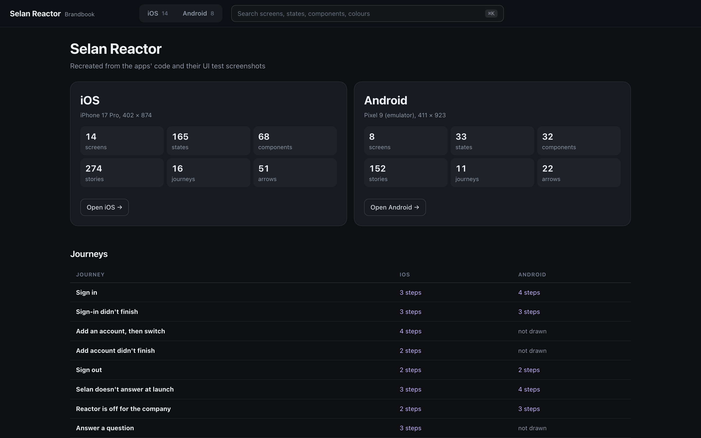
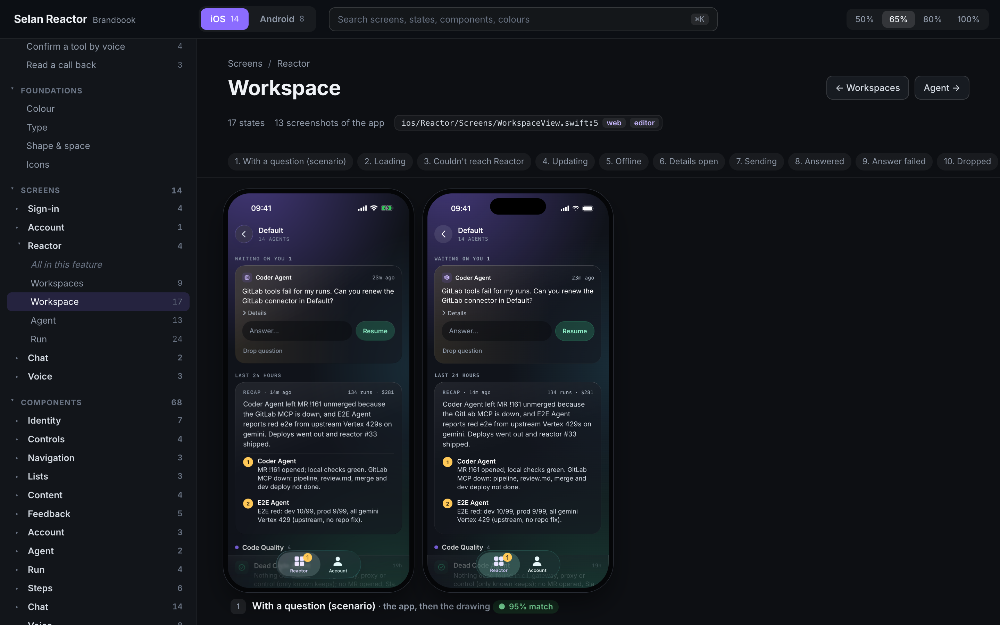
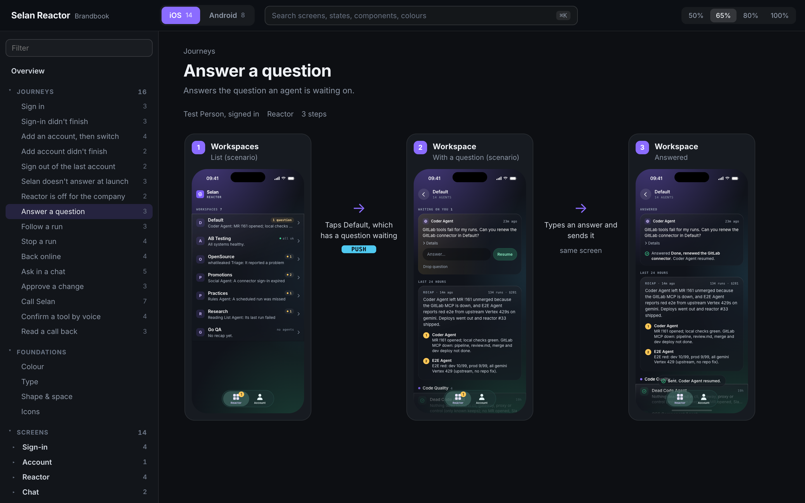
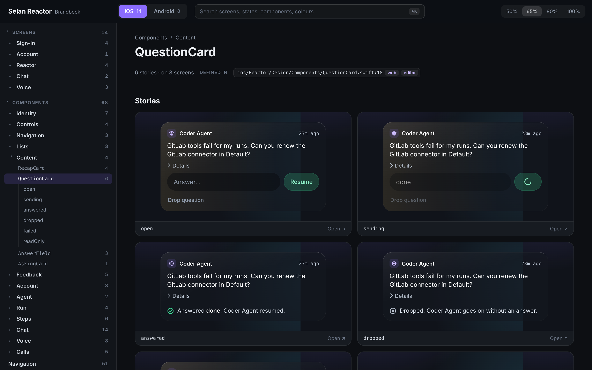
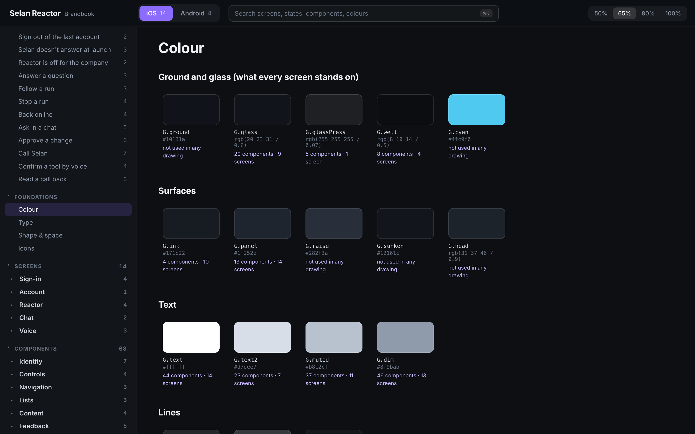
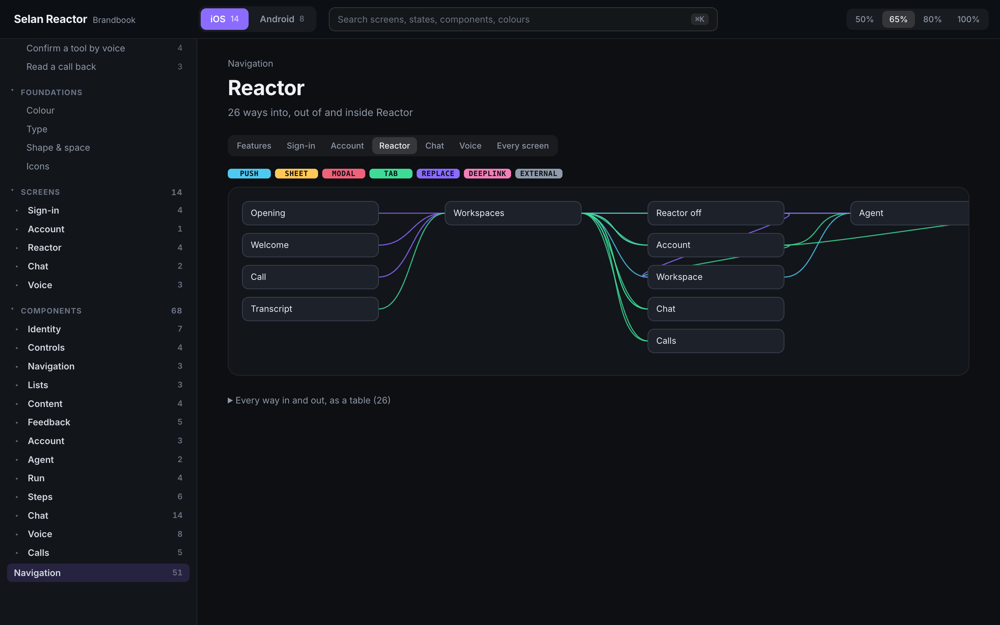
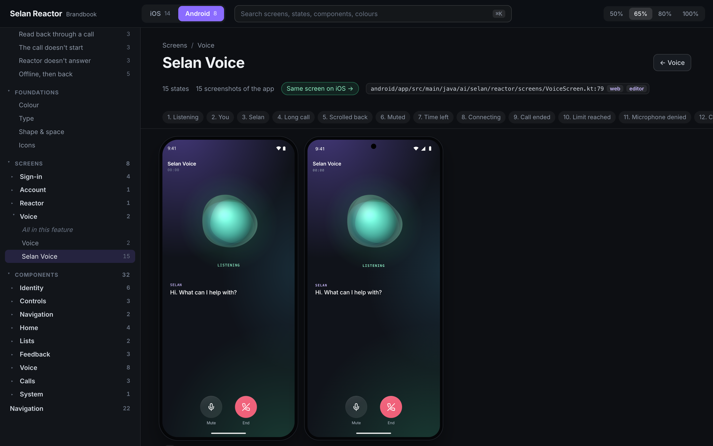

# whatishipped

Your mobile app's UI as it ships, recreated from its code and checked against its own screenshots.

A [Claude Code](https://claude.com/claude-code) skill. Point it at an iOS or Android repo and it draws every screen in
every state, the components, colours and type, and the journeys through the app, as one brandbook you can run, host
and click through.



Design files drift. Figma shows what someone drew last spring; the app shows what shipped. whatishipped starts from
the other end, the code: it reads SwiftUI, UIKit, Jetpack Compose or XML views and draws each one in HTML. Then it puts
every drawing beside a screenshot of the real app and measures how much of it matches, so you know which screens to
trust.

---

## Install it

```
/plugin marketplace add selan-ai/whatishipped
/plugin install whatishipped@whatishipped
```

Or copy `skills/whatishipped` into `~/.claude/skills/`.

## Use it

Open Claude Code in the app's repo and ask for what you want:

```
Make a brandbook of this app.
Draw the checkout flow, on iOS and Android.
Just the design system: colours, type and components.
Add the settings screens to the brandbook in ~/brandbooks/acme.
```

What you ask for is what it draws. An app with more than about 25 screens gets a short list of journeys to choose
from first. It asks before it runs anything.

---

## What you get

Every screen in every state, with how much of it matches the app's own screenshot. Each state shows its drawing, with
a switch to the screenshot and to what differs, in red; a state that differs shows the app beside the drawing:



Journeys, step by step, through real screens and states:



Components laid out as Storybook does, each story drawn, with where it is defined and the screens that use it:



Colours grouped by what the code says they are for, type, shape and icons:



What opens what, read from the code:



Android gets the same, in its own folder, with the same journeys and features so the two line up:



The demo is [Selan Reactor](https://selan.ai), our own app, drawn with its test data: 22 screens, 198 states and 100
components on iOS and Android, 166 states measured against the app's UI test screenshots at 97% on average.

---

## How it matches the app

Code read alone gets spacing and variants wrong in ways no check catches. A board drawn that way matched its app about
80%. So every screen gets a screenshot first, from the cheapest place that has one:

1. **The repo.** UI test references, snapshot tests, store screenshots. No run, no question.
2. **The E2E tests**, run while `server/capture.ts` watches the simulator or emulator and keeps each screen that
   settles, tagged with the test that reached it. It asks first: tests can need a secret, write to a backend or take
   hours.
3. **You.** Tap through the app while it captures, or send screenshots.

`check.ts --compare` then draws each state alone at its screenshot's exact size and counts how much of the screen's
content matches, point for point. A drawing right to the point scores 97 to 100; one two points off, about 92; the
wrong screen, under 75. A state is done at 95, or when what still differs comes from the screenshot (the test
account's own titles, its clock) and the drawing says so. It saves the app, the drawing and every point that differs
in red, side by side, and fixes the worst first.

## Run and host it

The brandbook is a folder with a small Node server and no dependencies:

```sh
cd ~/brandbooks/acme && npm start      # http://localhost:4321, Node 22.18 or later
docker build -t brandbook . && docker run -p 8080:8080 brandbook
npm run build                          # static files in dist/, for any host that serves a folder
```

We host ours on Cloudflare: `dist/` as a Worker with only static assets, and Cloudflare Access on its hostname so only
the team can open it. Everything in the folder is served, the screenshots too. Keep a person's own account out of
anything you host.

## What it needs

- Claude Code. A whole app is a big job: the demo took eight agents, drawing in parallel, about an hour.
- Node 22.18 or later, and Google Chrome for the checks.
- libwebp's `cwebp` and `dwebp` (`brew install webp`): every screenshot and image is stored as lossless WebP.
- Xcode's simulator or `adb` only to capture screenshots.

No npm packages, anywhere.

## What it will never do

- Change the app's tracked files. It reads the repos and runs their tests as they are, and leaves `git status` as it
  found it.
- Run your tests, or anything else, without asking.
- Publish or upload anything.

---

## Ideas

What we would build next is in [IDEAS.md](IDEAS.md). Tell us in an issue which you want.

## Disclosure

Built by [Selan](https://selan.ai), to draw our own app. Everything in the demo is that app with its test data.

## Contributing

The skill is Markdown (`skills/whatishipped/SKILL.md` and the briefs beside it) and the brandbook it copies into each
new board (`skills/whatishipped/template`): TypeScript run directly by Node, with no build and no packages. Try a
change on a real repo, then check the board it made:

```sh
node server/check.ts --all http://localhost:4321        # every page draws without an error
node server/check.ts --compare http://localhost:4321    # every drawing against its screenshot
```

## License

MIT.
